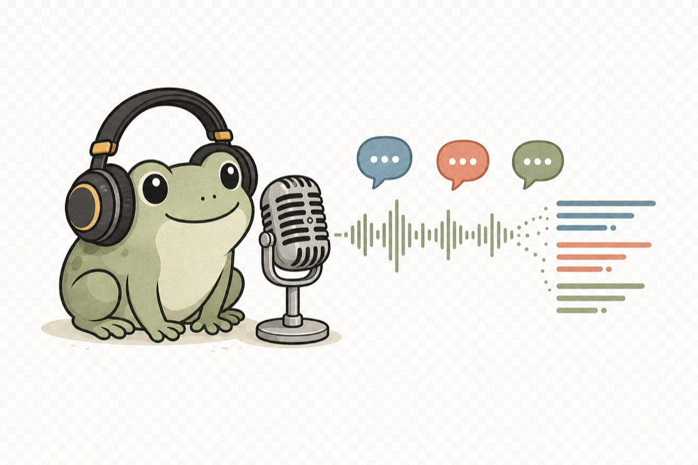
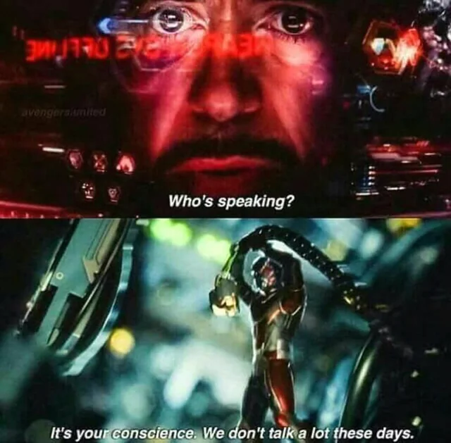
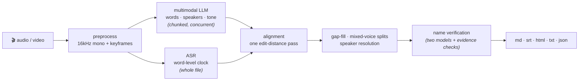

<!-- prettier-ignore-start -->
<div align="center">



# offmute-v2

**State-of-the-art meeting transcription.**<br>
Every word on the right millisecond. Every speaker told apart — and named.

<br>

```bash
npx offmute-v2 meeting.mp4
```

[](https://www.npmjs.com/package/offmute-v2)&nbsp;
[](LICENSE)&nbsp;
[](#requirements)&nbsp;
[](#the-story)

**[Quick start](#quick-start)** · **[What you get](#what-you-get)** · **[Why it's accurate](#why-its-accurate)** · **[Zero storage](#zero-storage)** · **[Daemon](#daemon-mode)** · **[Costs](#costs-you-can-see)** · **[CLI](#cli-reference)** · **[Library](#library)** · **[The story](#the-story)**

</div>
<!-- prettier-ignore-end -->

---

<div align="center">



_the eternal diarization problem — Tony had **one** unknown speaker and an AI in his helmet, and still needed help_

</div>

Speech-to-text is a solved problem. _Meetings_ are not: who said what, through interruptions,
across an hour, with names attached and timestamps you can trust. Every tool picks one half —
ASR services nail the clock but garble the people; LLMs understand the people but
[hallucinate the clock](#why-its-accurate). offmute-v2 runs both and fuses them, word by word.

The result: **best-in-class WER, ~99% speaker attribution, sub-second turn boundaries** on
hand-checked real recordings — with speakers identified _by name_ from context alone, and every
name verified by a second model before it ships.

## Quick start

```bash
export GEMINI_API_KEY=...        # the ears  (aistudio.google.com/apikey)
export ASSEMBLYAI_API_KEY=...    # the clock (assemblyai.com — $0.15/hr)

npx offmute-v2 meeting.mp4
# → meeting.md, right next to meeting.mp4
```

That's the whole thing. First run checks your setup and tells you what any missing keys would
unlock. Every run shows you what it will cost before spending, works through the meeting in
front of you (one cell per ten-minute chunk, with the word clock running alongside), and says
what it spent after:

```text
offmute-v2 0.2.0  design-review.m4a
  cache /var/folders/…/offmute-v2-design-review-5d2e81c0
✓ prepared the media  1s
  16 min of audio · gemini-4-hydrogen · timed by AssemblyAI · ~$0.25 estimated
  zero storage

✓ timed every word · AssemblyAI · 2,549 words · 2 voices · English  13s
✓ listened for who's there  17s
  A product design review: two engineers walk through the onboarding flow and agree what…
✓ transcribed  ▰▰  2 chunks  46s
✓ matched lines to the word times  0s
✓ told the voices apart  0s
  ◆ Speaker A → Priya · Speaker B → Jay
✓ named the speakers · gemini-flash-latest  3s
✓ finished  0s

  receipt 4 LLM calls · 53k in / 21k out · ~$0.27 · 1m12s
     gemini-4-hydrogen: 3 calls · 47.1k in / 20.4k out · $0.22
     gemini-flash-latest: 1 call · 5.6k in / 157 out · $0.01
     assemblyai: 16min · $0.04

✓ 212 segments · 2 speakers · 15m 38s of audio · ~$0.27 · 1m 12s

  → /Users/you/design-review.md
```

Stop it whenever you like (Ctrl-C, a closed laptop): run the same command again and it carries
on from what finished, AssemblyAI's job included.

## What you get

A transcript that reads like a person took minutes, timed like a machine kept the clock:

```markdown
## Speakers

- **Hanjun Kim** — 4m 37s
- **Ang Li** — 6m 30s
- **Moderator** — 5m 30s

## Transcript

`[00:32]` **Hayden Salmon:** I said 25%. I was wrong.

`[00:35]` **Ang Li:** I said 5%.

`[00:46]` **Hanjun Kim:** Hey everybody. I'm Hanjun Kim. I'm a strategy professor at INSEAD,
and I study how the economics of building, scaling, and designing companies are changing with AI.
```

Same-speaker runs merge into readable paragraphs; tone shows up only when it matters
(_(laughing)_, _(sarcastic)_) instead of decorating every line. One file by default; five formats
when you want them:

| format           | what it's for                                                                            |
| ---------------- | ---------------------------------------------------------------------------------------- |
| `md` _(default)_ | the transcript you actually read — merged paragraphs, `[mm:ss]` anchors                  |
| `srt`            | subtitles — cue width capped, timing word-accurate, drop straight onto the video         |
| `html`           | one self-contained shareable page — speaker colors, click-to-copy timestamps, no JS deps |
| `txt`            | plain text for grepping and piping                                                       |
| `json`           | every segment with `start`/`end`, speaker, tone, confidence, word-level timings          |

Add `--summary` for a `meeting.summary.md` with the TL;DR, decisions, and action items.

## Why it's accurate

Multimodal LLMs are the best diarizers in the world — they follow speakers through
interruptions, infer names from "hey everybody, I'm Hanjun", and hear tone. They are also
_hopeless_ at time: left alone, Gemini's timestamps drift **minutes** over a long recording.
ASR services are the mirror image: word timings accurate to centiseconds, but speakers as
anonymous clusters and text that keeps every "um".

So each does the half it's the best in the world at:



The fuse is a [Needleman–Wunsch](https://en.wikipedia.org/wiki/Needleman%E2%80%93Wunsch_algorithm)
alignment over the two word streams — the LLM's text inherits the ASR's clock. Around that core,
the seams that actually determine day-to-day quality:

- **Names shown are names verified.** Two different reasoner models read the full transcript and
  name the speakers independently. They must agree — or produce an evidence quote that actually
  appears in the transcript. A stated self-introduction outranks both; an unresolvable
  disagreement stays an honest `Speaker A` rather than becoming a confident guess. One person
  can never be two voices.
- **Conversation partners never merge.** ASR diarizers over-split one voice into two clusters;
  naive fixes merge them back by label — and fuse two _real people_ when the LLM mislabels.
  offmute-v2 checks the turn-taking pattern: clusters that alternate like a conversation are
  different humans, whatever the labels say.
- **Mega-segments get split at voice boundaries.** When the LLM folds someone's interjection
  into another speaker's turn, word-level timing exposes the foreign voice and the segment is
  split at the exact word.
- **Chunk seams never double-print.** Segments are ownership-partitioned across chunk overlaps,
  and boundary-spanning duplicates are trimmed word-by-word. Each chunk's own timestamps are
  moved onto the ASR's clock first, so a chunk whose clock runs early keeps its opening lines.
- **A chunk that comes back short is redone.** Every chunk's word count is checked against what
  the ASR heard in the same stretch. A reply that stopped early, a `[silence]` placeholder over
  real talk, or a repetition loop leaves too few words; the chunk is transcribed again in two
  halves and the fuller version kept.
- **Nothing silently goes stale.** Every stage caches to disk, keyed on the input file _and_ the
  config — change the model and the cache invalidates itself. Re-run for a new format and it's
  ~2 seconds and $0.00. Kill it mid-run and it resumes where it stopped.

Measured on a hand-checked 32-minute talk with audience Q&A: **≈8% WER, ~99% word-level speaker
attribution, first cue within 40ms of reference.** Receipts, methodology, and an independent
re-score live in `[docs/](https://github.com/SouthBridgeAI/offmute-v2/tree/fable/docs)` and the
[write-up](https://southbridge.ai/blog/offmute-v2-glm-vs-opus).

## Daemon mode

Point it at the folder your recorder drops files into, and stop thinking about it:

```bash
offmute-v2 watch ~/Recordings --summary
```

- waits for files to finish copying before starting (size-stability check)
- never reprocesses a finished file, across restarts — killed jobs resume from cache
- OS notification when each transcript lands
- `--jobs N` to run several at once, `--no-backlog` to skip what's already there

## Costs you can see

An honest tool tells you what it's about to spend:

- **estimate before any paid call** — duration-based, per provider, printed up front
- **itemized receipt after** — real token counts, per model, embedded in the JSON metadata too
- **lifetime accounting** — `offmute-v2 stats` shows hours processed, characters produced, and
  cost by model, accumulated in `~/.offmute`

Typical numbers: a 30-minute meeting on the default model, `gemini-4-hydrogen`, runs
≈ **$0.40–0.80**, thinking tokens included. `--pro` uses `gemini-4-argon`, which kept a little
more speech in our tests at about 1.7× the time, and costs about twice as much from 1 December 2026. `--model gemini-3.8-flash` costs about a third as much (until 1 January 2027) but dropped
more speech on hard audio.

## Zero storage

Google's Gemini API now keeps the requests of new paid projects for 55 days by default (from
26 October 2026), unless a request asks it not to. offmute asks, on every call, unless you turn
it off:

- **Gemini** — every request carries `store: false`, and each uploaded audio file is deleted as
  soon as its call returns. Speaker naming on Gemini goes through Gemini's own API, where the
  ask is honoured (its OpenAI-compatible endpoint rejects it).
- **AssemblyAI** — the transcript is deleted from AssemblyAI the moment offmute has its own copy
  (AssemblyAI deletes uploaded audio within 48 hours either way).
- **Everyone else** — DeepSeek, OpenAI, Groq, ElevenLabs and the rest have no way to be asked
  per request, so each run's plan line names the ones it will use:
  `zero storage · deepseek-chat can't be asked to keep nothing`. For a run that stays on
  providers that can be asked: `--reasoner gemini-flash-latest --identify single`, with the
  default `--timestamped assemblyai`.

`--no-zero-storage` turns the asks off and leaves each provider to its own retention.

## Fix a name in two seconds

The models only have the audio — if nobody says their own name, you'll get an honest
`Speaker A`. Fixing it doesn't cost a re-run:

```bash
offmute-v2 rename meeting.mp4 "Speaker A=Priya" "Speaker B=Jay"
```

It finds the run's cache, applies the names, regenerates the outputs, and remembers the fix for
future re-runs. Or tell it who was in the room up front: `--speakers "Priya,Jay"` — if one known
name is left over and one voice unnamed, they bind by elimination.

## CLI reference

```bash
offmute-v2 <input> [options]      # transcribe (default command)
```

| option                                  | default               |                                                                 |
| --------------------------------------- | --------------------- | --------------------------------------------------------------- |
| `-o, --output <dir>`                    | next to input         | where transcripts land                                          |
| `--formats <list>`                      | `md`                  | any of `md,srt,txt,html,json`                                   |
| `--summary`                             | off                   | also write TL;DR / decisions / action items                     |
| `--instructions <text>`                 | –                     | guide the ear: _"the host is Alice; spell it Xiao, not Shao"_   |
| `--speakers <names>`                    | –                     | who was in the room (helps naming; comma-separated)             |
| `--model <name>`                        | `gemini-4-hydrogen`   | any Gemini model id · `gemini-3.8-flash` ~⅓ the cost            |
| `--pro`                                 | off                   | `gemini-4-argon`: a little more speech, ~1.7× the time          |
| `--no-zero-storage`                     | asks for zero storage | let providers keep requests under their own retention           |
| `--language <code>`                     | detected by the ASR   | the recording's language, e.g. `ko`, `ml`, `hi`                 |
| `--timestamped <p>`                     | `assemblyai`          | `elevenlabs` (Scribe v2) · `whisper-groq` (free) · `none`       |
| `--reasoner <name>`                     | `deepseek-chat`       | naming/summary model — DeepSeek, Gemini, GLM, Kimi, GPT, Claude |
| `--level <1\|2\|3>`                     | `3`                   | 1 separation · 2 anonymous-consistent · 3 **verified names**    |
| `--identify <mode>`                     | `dual`                | two reasoners + adjudication · `single`                         |
| `--md-style <s>`                        | `merged`              | merged paragraphs · `turns` for one block per turn              |
| `--chunk-seconds` / `--overlap-seconds` | `600` / `60`          | chunking                                                        |
| `--force`                               | –                     | ignore caches and recompute                                     |
| `-i <dir>`                              | OS temp, per input    | cache location (printed each run)                               |

```bash
offmute-v2 watch <dir>       # daemon: transcribe files as they appear
offmute-v2 rename <file> "Old=New"   # retcon speaker names from the run cache
offmute-v2 models            # what each role can use + what your keys unlock
offmute-v2 doctor            # ffmpeg + keys + live API health check
offmute-v2 stats             # lifetime hours, characters, cost by model
```

## Library

```ts
import { transcribe } from "offmute-v2";

const { segments, speakers, metadata } = await transcribe({
  input: "meeting.mp4",
  formats: ["md", "json"],
  instructions: "Three-person panel; label by name.",
  apiKeys: { gemini: "...", assemblyai: "..." }, // optional — falls back to env
  // zeroStorage: false,                         // on by default, as in the CLI
  onProgress: (e) => {
    if (e.type === "chunk") console.log(`chunk ${e.index + 1}: ${e.state}`);
  },
});

console.log(segments[0]);
// { start: 0.16, end: 4.2, speaker: "Speaker A", speakerName: "Hanjun Kim",
//   text: "...", tone: ["laughing"], confidence: 0.97, words: [...] }
console.log(metadata.cost); // { estimatedUsd, actualUsd, lines, ... }
```

`onProgress` receives the same events the terminal display is drawn from: the plan (model,
estimate, which providers zero storage couldn't ask), each stage, each chunk, the ASR, the
coverage check redoing a chunk, the names, and the files written. Every pipeline stage
(`alignSegments`, `assignGlobalSpeakers`, `identifySpeakersV2`, the formatters) is exported
individually — bring your own pipeline if you like. A browser build of the pure fusion core
ships as `offmute-v2/browser` (fetch providers + optional ffmpeg.wasm).

## What can go wrong (honestly)

- **Two similar voices, nobody says a name** → you get correct turn-taking with `Speaker A/B`
  labels, not a confident wrong guess. That's by design; `rename` or `--speakers` closes the gap.
- **Heard names get spelled by ear** — "Hanjun" may render as "Hanjin" between runs. The
  recording's filename and your `--instructions` both feed the namer; `rename` fixes stragglers.
- **Network blips** → every upload retries with backoff for ~90s; if a run still dies, re-running
  resumes from cache and re-pays nothing that finished.
- **It costs money** — roughly a dollar an hour of audio on the best models, a third of that on
  flash. The estimate prints before anything is spent.
- **A language the ASR mishears** → AssemblyAI now detects each file's language, but if the ASR
  still hears almost nothing, offmute says so and times the lines from the LLM alone;
  `--language ko` (or `ml`, `hi`, …) pins the language.

## Requirements

- **Node ≥ 20** and **ffmpeg** in PATH (`brew install ffmpeg` / `apt install ffmpeg`)
- `GEMINI_API_KEY` (or `GOOGLE_API_KEY`) — required, the ears
- One clock, strongly recommended: `ASSEMBLYAI_API_KEY` (default) · `ELEVENLABS_API_KEY`
  (Scribe v2 — the sharpest diarization we've tested) · `GROQ_API_KEY` (free whisper timing)
- Nice-to-have: `DEEPSEEK_API_KEY` — makes speaker naming cost ~$0.003 a run (DeepSeek can't be
  asked for zero storage)

Keys can also be injected via the library API instead of the environment. Run
`offmute-v2 doctor` to see where you stand.

## The story

This repo is an experiment receipt as much as a tool. The same brief — fuse
[offmute](https://github.com/southbridgeai/offmute)'s LLM diarization,
[meeting-diary](https://github.com/hrishioa/meeting-diary)'s ASR timing, and
[ipgu](https://github.com/hrishioa/ipgu)'s alignment discipline — was given independently to two
frontier models working autonomously. Both built the whole thing; both landed on the same
architecture; the differences live in the seams. Their unedited process logs, self-reviews, and
my manual reviews are preserved on the
`[glm](https://github.com/SouthBridgeAI/offmute-v2/tree/glm)` and
`[opus](https://github.com/SouthBridgeAI/offmute-v2/tree/opus)` branches, published as
`offmute-v2@glm` and `offmute-v2@opus`. A third line — this one,
`offmute-v2@fable`, now the primary — took everything both learned and kept going.

Full write-up: **["The frontier is open-source today"](https://southbridge.ai/blog/offmute-v2-glm-vs-opus)**.

## Development

```bash
git clone https://github.com/SouthBridgeAI/offmute-v2 && cd offmute-v2
npm install
npm test          # vitest
npm run typecheck # strict tsc
npm run dev -- path/to/file.mp4
```

Releases ship via npm Trusted Publishing — see
[RELEASING.md](https://github.com/SouthBridgeAI/offmute-v2/blob/fable/RELEASING.md) for the
branch/dist-tag map.

---

Built by [Southbridge](https://southbridge.ai) · created by [Hrishi Olickel](https://twitter.com/hrishioa)

If offmute-v2 saved you an afternoon of "who said that?", **[a star](https://github.com/SouthBridgeAI/offmute-v2)** keeps the frog listening. 🐸
