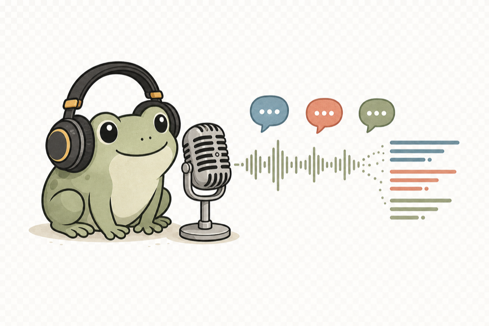
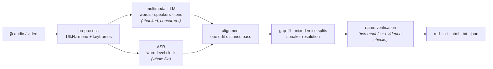

<div align="center">



# offmute-v2

**State-of-the-art meeting transcription: every word on the right millisecond, every speaker told apart and named.**

```bash
npx offmute-v2@fable meeting.mp4
```

[](https://www.npmjs.com/package/offmute-v2)
[](LICENSE)
[](#requirements)
[](#the-story)

[Quick start](#quick-start) · [What you get](#what-you-get) · [Why it's accurate](#why-its-accurate) ·
[Daemon mode](#daemon-mode) · [Costs](#costs-you-can-see) · [CLI](#cli-reference) · [Library](#library) · [The story](#the-story)

</div>

---

Speech-to-text is a solved problem. *Meetings* are not: who said what, through interruptions,
across an hour, with names attached and timestamps you can trust. Every tool picks one half —
ASR services nail the clock but garble the people; LLMs understand the people but
[hallucinate the clock](#why-its-accurate). offmute-v2 runs both and fuses them, word by word.

The result: **~8% word error rate, ~99% speaker attribution, sub-second turn boundaries** on
hand-checked real recordings — with speakers identified *by name* from context alone, and every
name verified by a second model before it ships.

## Quick start

```bash
export GEMINI_API_KEY=...        # the ears  (aistudio.google.com/apikey)
export ASSEMBLYAI_API_KEY=...    # the clock (assemblyai.com — $0.15/hr)

npx offmute-v2@fable meeting.mp4
# → meeting.md, right next to meeting.mp4
```

That's the whole thing. First run checks your setup and tells you what any missing keys would
unlock. Every run shows you what it will cost before spending, and what it spent after:

```text
offmute-v2 0.1.0-fable.0  team-call.mp4

  estimate ~$0.30  [gemini-3.1-pro-preview: 4 chunks + describe ≈ $0.22 · assemblyai: 28min ≈ $0.07 · …]
✓ preparing media · extracting keyframes 28s
✓ listening for context 41s
✓ transcribing 3/3 chunks 38s
✓ timestamps (AssemblyAI) · 154 utterances, 5813 words, 2 speakers 23s
✓ aligning timestamps · split 3 mixed-voice boundaries 0s
✓ resolving speakers 0s
  ◆ identified 3 speakers: {"Speaker A":"Hrishi","Speaker B":"Chibi","Speaker C":"Daniel"}
✓ naming speakers (deepseek-chat + gemini-flash-latest second opinion) 12s
✓ finalizing · 65 segments 0s
  receipt 6 LLM calls · 63k in / 12k out · ~$0.32 · 2m49s

  → /Users/you/team-call.md

65 segments · 3 speakers · 23m of audio · ~$0.32 · 2m 49s
```

## What you get

A transcript that reads like a person took minutes, timed like a machine kept the clock:

```markdown
## Speakers

- **Hanjun Kim** — 4m 37s
- **Ang Li** — 6m 30s
- **Moderator** — 5m 30s

## Transcript

`[00:32]` **Hayden Salmon:** I said 25%. I was wrong.

`[00:35]` **Ang Li:** I said 5%.

`[00:46]` **Hanjun Kim:** Hey everybody. I'm Hanjun Kim. I'm a strategy professor at INSEAD,
and I study how the economics of building, scaling, and designing companies are changing with AI.
```

Same-speaker runs merge into readable paragraphs; tone shows up only when it matters
(*(laughing)*, *(sarcastic)*) instead of decorating every line. One file by default; five formats
when you want them:

| format | what it's for |
| ------ | ------------- |
| `md` *(default)* | the transcript you actually read — merged paragraphs, `[mm:ss]` anchors |
| `srt`  | subtitles — cue width capped, timing word-accurate, drop straight onto the video |
| `html` | one self-contained shareable page — speaker colors, click-to-copy timestamps, no JS deps |
| `txt`  | plain text for grepping and piping |
| `json` | every segment with `start`/`end`, speaker, tone, confidence, word-level timings |

Add `--summary` for a `meeting.summary.md` with the TL;DR, decisions, and action items.

## Why it's accurate

Multimodal LLMs are the best diarizers in the world — they follow speakers through
interruptions, infer names from "hey everybody, I'm Hanjun", and hear tone. They are also
*hopeless* at time: left alone, Gemini's timestamps drift **minutes** over a long recording.
ASR services are the mirror image: word timings accurate to centiseconds, but speakers as
anonymous clusters and text that keeps every "um".

So each does the half it's the best in the world at:



The fuse is a [Needleman–Wunsch](https://en.wikipedia.org/wiki/Needleman%E2%80%93Wunsch_algorithm)
alignment over the two word streams — the LLM's text inherits the ASR's clock. Around that core,
the seams that actually determine day-to-day quality:

- **Names shown are names verified.** Two different reasoner models read the full transcript and
  name the speakers independently. They must agree — or produce an evidence quote that actually
  appears in the transcript. A stated self-introduction outranks both; an unresolvable
  disagreement stays an honest `Speaker A` rather than becoming a confident guess. One person
  can never be two voices.
- **Conversation partners never merge.** ASR diarizers over-split one voice into two clusters;
  naive fixes merge them back by label — and fuse two *real people* when the LLM mislabels.
  offmute-v2 checks the turn-taking pattern: clusters that alternate like a conversation are
  different humans, whatever the labels say.
- **Mega-segments get split at voice boundaries.** When the LLM folds someone's interjection
  into another speaker's turn, word-level timing exposes the foreign voice and the segment is
  split at the exact word.
- **Chunk seams never double-print.** Segments are ownership-partitioned across chunk overlaps,
  and boundary-spanning duplicates are trimmed word-by-word.
- **Nothing silently goes stale.** Every stage caches to disk, keyed on the input file *and* the
  config — change the model and the cache invalidates itself. Re-run for a new format and it's
  ~2 seconds and $0.00. Kill it mid-run and it resumes where it stopped.

Measured on a hand-checked 32-minute talk with audience Q&A: **≈8% WER, ~99% word-level speaker
attribution, first cue within 40ms of reference.** Receipts, methodology, and an independent
re-score live in [`docs/`](docs/) and the [write-up](https://southbridge.ai/blog/offmute-v2-glm-vs-opus).

## Daemon mode

Point it at the folder your recorder drops files into, and stop thinking about it:

```bash
offmute-v2 watch ~/Recordings --summary
```

- waits for files to finish copying before starting (size-stability check)
- never reprocesses a finished file, across restarts — killed jobs resume from cache
- OS notification when each transcript lands
- `--jobs N` to run several at once, `--no-backlog` to skip what's already there

## Costs you can see

An honest tool tells you what it's about to spend:

- **estimate before any paid call** — duration-based, per provider, printed up front
- **itemized receipt after** — real token counts, per model, embedded in the JSON metadata too
- **lifetime accounting** — `offmute-v2 stats` shows hours processed, characters produced, and
  cost by model, accumulated in `~/.offmute`

Typical numbers: a 30-minute meeting on the default (best) model runs ≈ **$0.30–0.45**;
`--model gemini-3.5-flash` cuts that ~4× with quality that holds up remarkably well.

## Fix a name in two seconds

The models only have the audio — if nobody says their own name, you'll get an honest
`Speaker A`. Fixing it doesn't cost a re-run:

```bash
offmute-v2 rename meeting.mp4 "Speaker A=Priya" "Speaker B=Jay"
```

It finds the run's cache, applies the names, regenerates the outputs, and remembers the fix for
future re-runs. Or tell it who was in the room up front: `--speakers "Priya,Jay"` — if one known
name is left over and one voice unnamed, they bind by elimination.

## CLI reference

```bash
offmute-v2 <input> [options]      # transcribe (default command)
```

| option | default | |
| ------ | ------- | --- |
| `-o, --output <dir>` | next to input | where transcripts land |
| `--formats <list>` | `md` | any of `md,srt,txt,html,json` |
| `--summary` | off | also write TL;DR / decisions / action items |
| `--instructions <text>` | – | guide the ear: *"the host is Alice; spell it Xiao, not Shao"* |
| `--speakers <names>` | – | who was in the room (helps naming; comma-separated) |
| `--model <name>` | `gemini-3.1-pro-preview` | `gemini-3.5-flash` for ~4× cheaper/faster |
| `--timestamped <p>` | `assemblyai` | `elevenlabs` (Scribe v2) · `whisper-groq` (free) · `none` |
| `--reasoner <name>` | `deepseek-chat` | naming/summary model — DeepSeek, Gemini, GLM, Kimi, GPT, Claude |
| `--level <1\|2\|3>` | `3` | 1 separation · 2 anonymous-consistent · 3 **verified names** |
| `--identify <mode>` | `dual` | two reasoners + adjudication · `single` |
| `--md-style <s>` | `merged` | merged paragraphs · `turns` for one block per turn |
| `--chunk-seconds` / `--overlap-seconds` | `600` / `60` | chunking |
| `--force` | – | ignore caches and recompute |
| `-i <dir>` | OS temp, per input | cache location (printed each run) |

```bash
offmute-v2 watch <dir>       # daemon: transcribe files as they appear
offmute-v2 rename <file> "Old=New"   # retcon speaker names from the run cache
offmute-v2 models            # what each role can use + what your keys unlock
offmute-v2 doctor            # ffmpeg + keys + live API health check
offmute-v2 stats             # lifetime hours, characters, cost by model
```

## Library

```ts
import { transcribe } from "offmute-v2";

const { segments, speakers, metadata } = await transcribe({
  input: "meeting.mp4",
  formats: ["md", "json"],
  instructions: "Three-person panel; label by name.",
  apiKeys: { gemini: "...", assemblyai: "..." }, // optional — falls back to env
});

console.log(segments[0]);
// { start: 0.16, end: 4.2, speaker: "Speaker A", speakerName: "Hanjun Kim",
//   text: "...", tone: ["laughing"], confidence: 0.97, words: [...] }
console.log(metadata.cost); // { estimatedUsd, actualUsd, lines, ... }
```

Every pipeline stage (`alignSegments`, `assignGlobalSpeakers`, `identifySpeakersV2`, the
formatters) is exported individually — bring your own pipeline if you like. A browser build of
the pure fusion core ships as `offmute-v2/browser` (fetch providers + optional ffmpeg.wasm).

## What can go wrong (honestly)

- **Two similar voices, nobody says a name** → you get correct turn-taking with `Speaker A/B`
  labels, not a confident wrong guess. That's by design; `rename` or `--speakers` closes the gap.
- **Heard names get spelled by ear** — "Hanjun" may render as "Hanjin" between runs. The
  recording's filename and your `--instructions` both feed the namer; `rename` fixes stragglers.
- **Network blips** → every upload retries with backoff for ~90s; if a run still dies, re-running
  resumes from cache and re-pays nothing that finished.
- **It costs money** — roughly a dollar an hour of audio on the best models, a quarter of that on
  flash. The estimate prints before anything is spent.

## Requirements

- **Node ≥ 20** and **ffmpeg** in PATH (`brew install ffmpeg` / `apt install ffmpeg`)
- `GEMINI_API_KEY` (or `GOOGLE_API_KEY`) — required, the ears
- One clock, strongly recommended: `ASSEMBLYAI_API_KEY` (default) · `ELEVENLABS_API_KEY`
  (Scribe v2 — the sharpest diarization we've tested) · `GROQ_API_KEY` (free whisper timing)
- Nice-to-have: `DEEPSEEK_API_KEY` — makes speaker naming cost ~$0.003 a run

Keys can also be injected via the library API instead of the environment. Run
`offmute-v2 doctor` to see where you stand.

## The story

This repo is an experiment receipt as much as a tool. The same brief — fuse
[offmute](https://github.com/southbridgeai/offmute)'s LLM diarization,
[meeting-diary](https://github.com/hrishioa/meeting-diary)'s ASR timing, and
[ipgu](https://github.com/hrishioa/ipgu)'s alignment discipline — was given independently to two
frontier models working autonomously. Both built the whole thing; both landed on the same
architecture; the differences live in the seams. Their unedited process logs, self-reviews, and
my manual reviews are preserved on the [`glm`](../../tree/glm) and [`opus`](../../tree/opus)
branches, published as `offmute-v2@glm` and `offmute-v2@opus`. A third line — this one,
`offmute-v2@fable` — took everything both learned and kept going.

Full write-up: [**"The frontier is open-source today"**](https://southbridge.ai/blog/offmute-v2-glm-vs-opus).

## Development

```bash
git clone https://github.com/SouthBridgeAI/offmute-v2 && cd offmute-v2
npm install
npm test          # vitest
npm run typecheck # strict tsc
npm run dev -- path/to/file.mp4
```

Releases ship via npm Trusted Publishing — see [RELEASING.md](RELEASING.md) for the
branch/dist-tag map.

---

<div align="center">

Built by [Southbridge](https://southbridge.ai) · created by [Hrishi Olickel](https://twitter.com/hrishioa)

If offmute-v2 saved you an afternoon of "who said that?", **[a star](https://github.com/SouthBridgeAI/offmute-v2)** keeps the frog listening. 🐸

</div>
